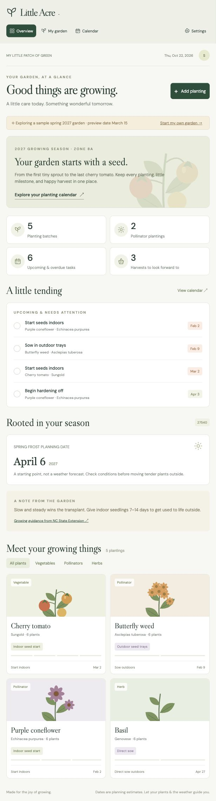
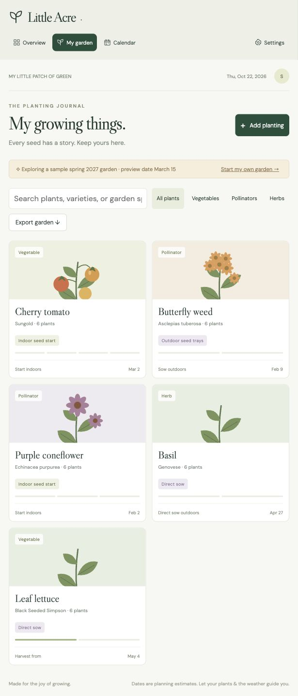
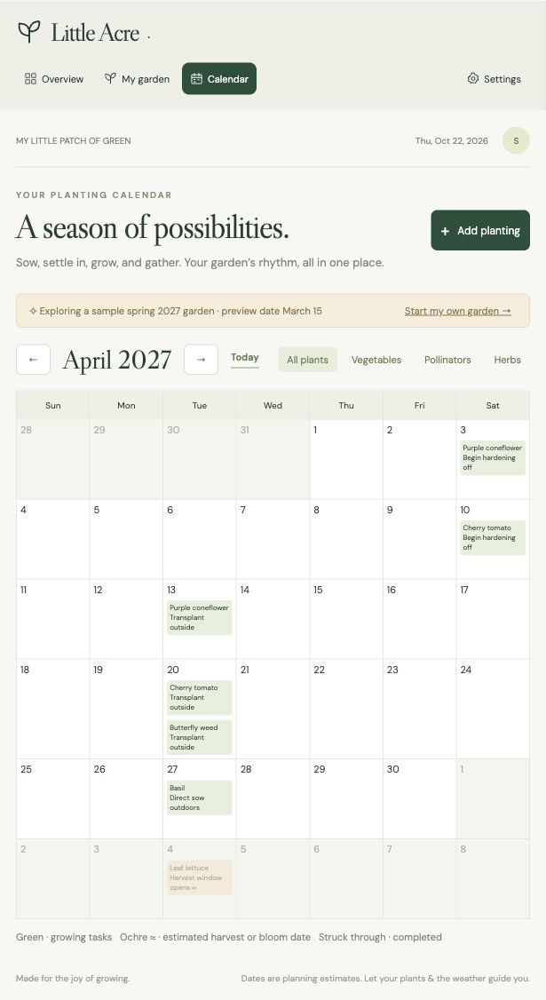

# Little Acre

A small, responsive garden planner made with plain JavaScript, CSS, and botanical SVG illustrations. No build step or runtime dependencies.

## Screenshots

The sample spring 2027 garden shows the dashboard, planting journal, and monthly calendar. Select an image to see it at full size.

| Overview | Planting journal | Calendar |
| --- | --- | --- |
|  |  |  |

## Run

From this folder, run `npm run dev`, then visit http://localhost:5173.

Run date calculation checks with `npm test`.

## What's here

- Overview with pending / overdue milestones and planting cards
- Individual planting batches for indoor seed starts, outdoor trays, direct sowing, or purchased transplants
- Editable sowing, hardening, and transplant dates; quantity, variety, garden spot, and field notes
- Packet-specific days to harvest / bloom, counted from sowing or transplanting
- Recording actual sow / transplant dates updates the related maturity estimate
- Unknown perennial bloom timing can be left at zero instead of assigning a first-year deadline
- Harvest / observation journal and repeat batches
- Monthly calendar, plant-type filters, and planting search
- Editable zone and seasonal frost dates
- Browser localStorage persistence with JSON backup export / import

The app starts with a clearly labeled sample spring 2027 garden, viewed as of March 15. Choose “Start my own garden” to remove the sample and begin your journal. Dates are estimates, not forecasts. There is no live weather, automatic ZIP lookup, push notification service, or account sync. Changing frost settings affects defaults for new plantings only.

## Growing references

The initial 27540 / zone 8a and approximate April 6 / November 3 frost dates are editable planning defaults. Seed timing is deliberately adjustable by cultivar, packet instructions, and conditions.

- https://www.plantmaps.com/27540
- https://croptrails.farm/frost-dates/27540
- https://content.ces.ncsu.edu/central-north-carolina-planting-calendar-for-annual-vegetables-fruits-and-herbs
- https://content.ces.ncsu.edu/home-vegetable-gardening-a-quick-reference-guide
- https://plants.ces.ncsu.edu/plants/asclepias-tuberosa/

Fonts use Google Fonts with system fallbacks. User garden records stay in the browser. Hosting via Sites was unavailable in this workspace; no remote site was created or published.
